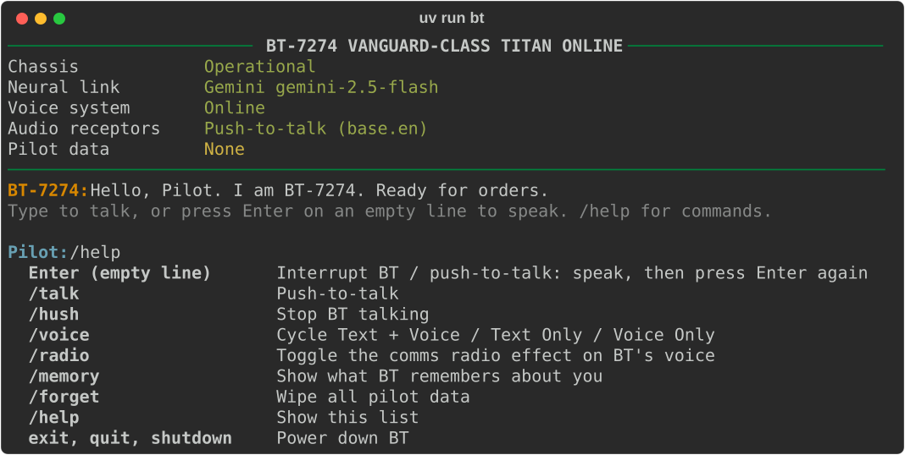

# BT-7274

An AI agent with the voice and personality of BT-7274, the Vanguard-class Titan from
Titanfall 2. Talk to him from your terminal — typed or out loud — and he answers in his own
voice, checks the weather, sets timers, keeps an eye on your machine, and remembers you
between sessions.



Built with [Gemini](https://ai.google.dev) (or a local model through
[Ollama](https://ollama.com)) as the brain, [Piper](https://github.com/OHF-Voice/piper1-gpl)
for BT's voice, and [faster-whisper](https://github.com/SYSTRAN/faster-whisper) for listening.

## What it does

- **Voice** — every reply is spoken in BT's own voice. He starts talking as soon as the
  first sentence is ready instead of waiting for the whole reply.
- **Push-to-talk** — press Enter on an empty line, speak, press Enter again. Speech is
  transcribed locally; only the text is sent to the model.
- **Tools** — weather, timers he announces out loud, a status report on your battery, CPU,
  memory and disk, the time, and opening links and apps.
- **Memory** — tell him something worth remembering and he stores it. Facts and recent
  conversation are kept between sessions, so he picks up where you left off.
- **Interrupting** — press Enter or send a new message and he stops mid-sentence.
- **Radio effect** — `/radio` runs his voice through a comms filter.
- **Offline mode** — swap Gemini for a local model through Ollama.

## Tech Stack


- **piper-tts** — runs the BT-7274 voice model (ONNX) in-process
- **faster-whisper** — local speech recognition for push-to-talk
- **google-genai** — Gemini streaming and function calling
- **sounddevice** — audio playback and microphone input
- **rich** — the terminal interface
- **Open-Meteo** — weather data, no API key needed

## Getting started

Requires [uv](https://docs.astral.sh/uv/) (`brew install uv` on macOS), which also installs
the right Python version for you.

```bash
git clone https://github.com/FilipKlaic/BT-AI-agent.git
cd BT-AI-agent
uv sync --extra listen
cp .env.example .env
```

Open `.env` and paste your Gemini API key after `GEMINI_API_KEY=` — you can get a free one
at [Google AI Studio](https://aistudio.google.com/apikey). Then:

```bash
uv run bt
```

> 🔑 Use your own API key. `.env` is gitignored, so it never ends up in the repo.

Leave out `--extra listen` if you don't want push-to-talk. The first time you use it, macOS
asks for microphone access for your terminal app, and the speech model (about 150 MB)
downloads once.

## Using it

Type to talk to BT. To talk out loud instead, press Enter on an empty line, speak, then
press Enter again to send. Ctrl+C while he's replying cuts him off; at the prompt it powers
him down.

| Command | Action |
| --- | --- |
| Enter on an empty line | Interrupt BT, then push-to-talk |
| `/talk` | Push-to-talk |
| `/hush` | Stop BT talking |
| `/voice` | Cycle between Text + Voice, Text Only and Voice Only |
| `/radio` | Toggle the comms radio effect |
| `/memory` | Show what BT remembers about you |
| `/forget` | Wipe all pilot data |
| `/help` | List commands |
| `exit` / `quit` / `shutdown` | Power down |

Some things to try: *"What's the weather in Stockholm?"*, *"Set a five minute timer for
tea"*, *"Status report"*, *"Open Spotify"*, *"Call me Cooper, and remember that."*

### Options

| Flag | What it does |
| --- | --- |
| `--backend ollama` | Use a local model through Ollama instead of Gemini |
| `--model NAME` | Pick a model, e.g. `gemini-2.5-flash` or `llama3.2` |
| `--text-only` | Don't load BT's voice |
| `--voice-only` | Speak replies without printing them |
| `--radio` | Start with the radio effect on |
| `--no-listen` | Don't load speech recognition |
| `--no-memory` | Don't load or save pilot data |
| `--fast` | Skip the boot and shutdown animation |

Every setting can also live in `.env` — see [`.env.example`](.env.example).

### Running offline

Install [Ollama](https://ollama.com), pull a model that supports tools, and point BT at it:

```bash
ollama pull llama3.2
uv run bt --backend ollama
```

Models without tool support still chat fine; BT just can't use his tools with them.

## What it can't do (yet)

- **Push-to-talk, not hands-free.** There's no wake word — you press Enter to start and
  stop listening.
- **Interrupting needs Enter.** BT stops when you press Enter or send a message, not on
  your first keystroke, because the terminal only hands over a line once it's submitted.
- **No web search.** Beyond the weather, he can't look things up online.
- **Opening apps is macOS-only**, and uses the app's name as macOS knows it.
- **Weather is metric** — °C and km/h.
- **Memory is a plain JSON file** at `~/.bt7274/memory.json`. `/forget` wipes it, and
  `--no-memory` skips it entirely.
- **The voice is English only.**

## How it works

A reply streams in from the model and runs through a sentence splitter. Every time a
sentence ends, it's cleaned up for speech — markdown stripped, `BT-7274` spelled out as
*seventy two seventy four* — and queued. One thread synthesizes queued sentences with Piper
while another plays them, so BT is already talking while the rest of the reply is being
generated. Interrupting him just drops whatever is still queued.

Tool calls happen mid-reply: the model asks for a tool, BT runs it and hands the result
back, and the reply carries on. Each tool is a plain Python function with a JSON schema,
which Gemini and Ollama both understand, so the two backends share one set of tools.

Only exchanges that succeed are saved. An API error mid-reply is shown to you, but never
fed back to the model as something BT said.

```
src/bt7274/
  __main__.py     CLI flags and startup
  config.py       settings from .env, BT's persona
  brain.py        Gemini and Ollama backends — streaming replies and tool calls
  tools.py        weather, timers, system status, links, apps, remember
  memory.py       pilot data in ~/.bt7274/memory.json
  speech.py       markdown cleanup and sentence splitting
  voice.py        Piper voice: synthesis and playback on separate threads
  effects.py      the comms radio filter
  listen.py       push-to-talk with faster-whisper
  terminal.py     boot screen, chat loop, commands
voice_model/      the BT-7274 Piper voice model (ONNX)
tests/
```

To give BT a new tool, write a function in `tools.py` that returns a dict and register it
in `build_toolbox()` with a JSON schema for its arguments. Both backends pick it up.

## Development

```bash
uv run pytest                           # fake model backends and a fake sound card
uv run ruff check . && uv run ruff format .
```

The tests never call a real API or play audio, so they run without a key or speakers.

## Status

**Done** — BT's voice with sentence-by-sentence streaming, push-to-talk, tools, memory
between sessions, the radio effect, and both Gemini and Ollama backends.

**Next** — web search, and a wake word so push-to-talk can go hands-free.

## Credits

- BT-7274 and Titanfall 2 belong to Respawn Entertainment and Electronic Arts. This is a
  fan project, not affiliated with either.
- Voice synthesis: [Piper](https://github.com/OHF-Voice/piper1-gpl)
- Speech recognition: [faster-whisper](https://github.com/SYSTRAN/faster-whisper)
- Weather: [Open-Meteo](https://open-meteo.com)
